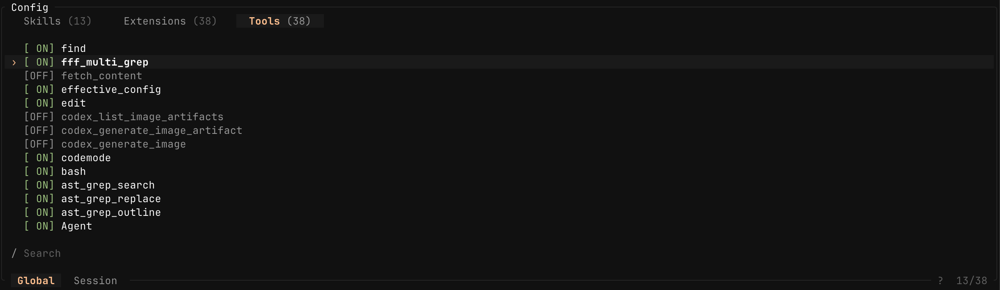

# pi-config-palette

Yet another config palette for Pi.

Toggle skills, extensions, and tools in one place. Skills and extensions use their existing global/project scope, tools get Global and Session modes.



## Install

Requires Pi `1.5.2+`.

```sh
pi install npm:pi-config-palette
```

Then `/reload` in Pi and run `/config-palette` (or `/resources`) because two names is important.

## Keys

| Key                 | Does the thing                               |
| ------------------- | -------------------------------------------- |
| `1` / `2` / `3`     | Skills / Extensions / Tools                  |
| `h` / `l`           | Switch tabs                                  |
| `j` / `k` or arrows | Move                                         |
| `Tab`               | Switch scope                                 |
| `Space` / `Enter`   | Toggle                                       |
| `/`                 | Fuzzy search                                 |
| `s`                 | Cycle ON-first / OFF-first / default sorting |
| `d`                 | Details                                      |
| `?`                 | Help, if this wasn't enough                  |
| `Esc`               | Leave search, clear filter, then close       |

**Toggles save immediately. Esc is not an undo button.** Toggle it back if you regret your choices.

Skill/extension changes reload Pi when you close the palette. Tool changes need no reload. Session tool choices beat Global ones and survive resume, but don't follow you into new sessions.

Tool toggles are preferences, **not security permissions**. Other extensions can change the active tools too.

## From your shell

```sh
npm install -g pi-config-palette
pi-config-palette
```

Run from your project. Needs `pi` on PATH. No chat, no model calls.

Tools are **cached, Global-only**. Refresh via `/config-palette` inside Pi in the same folder and trust state. Enabling a tool won’t enable its extension. Reload existing Pi sessions after shell skill/extension changes.

## Development

```sh
npm install
npm run check
npm test
```
